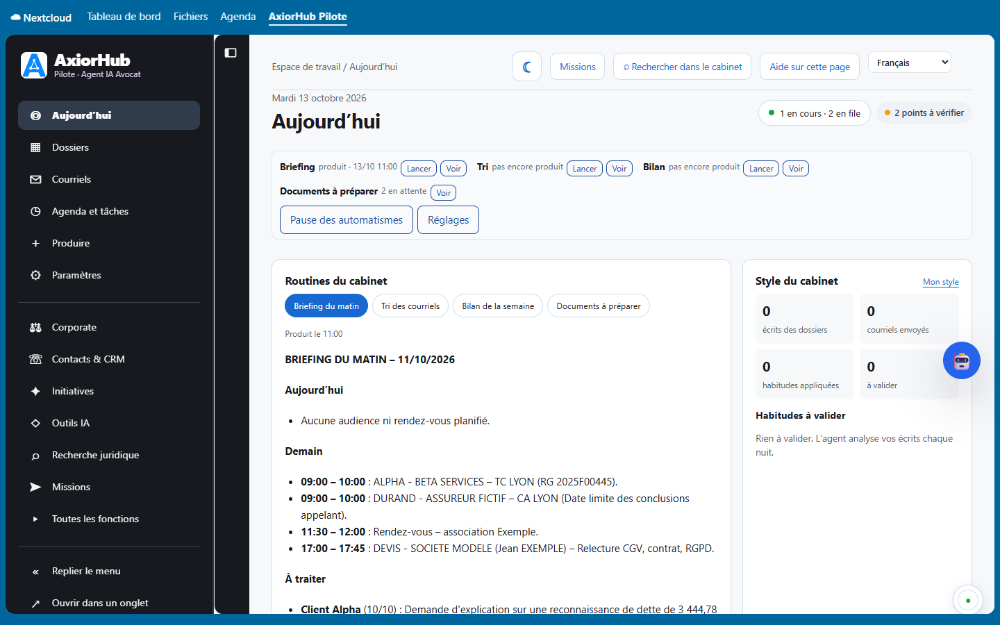

# AxiorHub Pilote pour Nextcloud (0.4.2, version de développement)

Application Nextcloud qui affiche **l'interface d'AxiorHub Pilote** — logiciel juridique destiné aux avocats français — dans Nextcloud :
dossiers, courriels, actes, Corporate, recherche juridique, Pilote. *English version below.*



**Cette application ne contient pas le moteur.** Elle fonctionne avec la **version serveur d'AxiorHub Pilote (5.6.41 ou ultérieure)**,
installée sur un **serveur Linux joignable en HTTPS par votre serveur Nextcloud**. Elle s'installe en trois étapes : le moteur sur le
serveur, l'application depuis la boutique Nextcloud, puis la liaison du compte de chaque avocat.

## Prérequis

| Élément | Exigence |
|---|---|
| Serveur | Linux **Ubuntu 24.04 LTS** ou **Debian 12** (64 bits), accès `sudo` |
| Mémoire et disque | 8 Go au moins sans IA locale (32 Go et idéalement une carte graphique pour une IA locale) ; 80 Go de disque ou plus |
| Nextcloud | **32 à 35**, derrière **Apache en HTTPS** (certificat valide), PHP 8.1 à 8.5, compte administrateur Nextcloud |
| Adresse d'AxiorHub | une adresse **HTTPS** joignable par le serveur Nextcloud ; le plus simple : `https://cloud.votre-cabinet.fr/agent-courriel/` (même domaine que Nextcloud) |
| Comptes | paramètres de la messagerie du cabinet (IMAP, SMTP) ; un compte Nextcloud technique avec **mot de passe d'application** |
| Durée | environ 45 minutes |

### Mode découverte : AxiorHub installé sur un poste de travail (tests seulement)

La version poste d'AxiorHub (Windows 11, Ubuntu poste) n'écoute que son propre ordinateur (`http://127.0.0.1:8769`). Elle peut servir avec cette application **en mode découverte, pour tester et découvrir l'application** :

- **Nextcloud installé sur le même ordinateur** (installation classique, ou Docker Desktop sous Windows) : dans AxiorHub, **Paramètres › Connexions › Application Nextcloud**, cochez « Autoriser la liaison des comptes depuis Nextcloud (même ordinateur) » ; dans Nextcloud, **Paramètres personnels › AxiorHub Pilote**, adresse `http://127.0.0.1:8769/agent-courriel` (Docker Desktop : `http://host.docker.internal:8769/agent-courriel`), cochez « Moteur sur ce serveur (adresse locale) », puis l'identifiant et le mot de passe locaux affichés dans ces mêmes paramètres d'AxiorHub. L'interface d'AxiorHub fonctionne dans Nextcloud, avec un bandeau d'avertissement permanent.
- **Nextcloud hébergé** (sur un serveur) : le serveur Nextcloud ne peut pas joindre votre ordinateur. Dans **Paramètres personnels › AxiorHub Pilote › Adresse de mon AxiorHub local**, saisissez `http://127.0.0.1:8769/agent-courriel/` : l'entrée **Mon AxiorHub local** du menu ouvre alors AxiorHub dans un nouvel onglet de votre navigateur (ni Pilote, ni recherche, ni affichage dans Nextcloud).

> **Avertissement — tests et découverte seulement.** AxiorHub n'est alors joignable que depuis cet ordinateur, s'arrête quand l'ordinateur est éteint, et les échanges locaux ne sont pas chiffrés (HTTP). Pour le travail du cabinet, installez la **version serveur** (étape 1) : plus sûre (HTTPS), sauvegardée et joignable depuis tous les postes.

## Étape 1 — Installer la version serveur d'AxiorHub (Linux)

Remplacez `cloud.votre-cabinet.fr` par l'adresse de votre Nextcloud.

```bash
# 1.1 Préparer le serveur
sudo apt update && sudo apt full-upgrade -y
sudo apt install -y git python3 python3-venv

# 1.2 Télécharger AxiorHub Pilote et construire l'archive vérifiée (manifeste d'empreintes contrôlé par l'installateur)
sudo git clone --branch v5.6.41 https://github.com/Arthur-Llevelys/AxiorHub-Pilote.git /opt/axiorhub-src
cd /opt/axiorhub-src
sudo python3 scripts/build-release.py /tmp/axiorhub-mail-agent-5.6.41.tar.gz

# 1.3 Installer (ou mettre à jour) le moteur
cd /tmp && tar -xzf axiorhub-mail-agent-5.6.41.tar.gz && cd axiorhub-mail-agent-5.6.41
sudo bash install.sh

# 1.4 Configurer la messagerie, Nextcloud et l'IA, puis contrôler
sudo axiorhub-mail configure
sudo axiorhub-mail doctor

# 1.5 Publier l'interface sur l'adresse de Nextcloud (nom HTTPS existant, mot de passe de 16 caractères au moins)
sudo python3 /opt/axiorhub-mail-agent/current/install-interface.py
```

AxiorHub répond alors à `https://cloud.votre-cabinet.fr/agent-courriel/` (identifiant `admin`).

**1.6 Autoriser l'application** : dans AxiorHub, **Paramètres › Connexions › Application Nextcloud**, cochez « Autoriser la liaison des
comptes depuis Nextcloud » puis « Enregistrer ». Commencez en mode observation (rien n'est écrit) ; rien n'est jamais envoyé sans votre clic.

## Étape 2 — Installer l'application depuis la boutique Nextcloud

En administrateur Nextcloud : **Applications › Bureautique et texte › AxiorHub Pilote › Télécharger et activer** (ou recherchez
« AxiorHub Pilote »). En ligne de commande :

```bash
cd /chemin/vers/nextcloud
sudo -u www-data php occ app:install axiorhub_pilote
```

Les mises à jour apparaissent ensuite dans **Applications › Mises à jour**.

### Sans la boutique (installation manuelle)

Tant que l'application n'apparaît pas dans votre boutique, ou sur un serveur sans accès à la boutique :

```bash
cd /tmp && git clone --branch v0.4.2 https://github.com/Arthur-Llevelys/AxiorHub-Pilote-Nextcloud.git axh-app
python3 axh-app/scripts/build-package.py /tmp/axiorhub_pilote-0.4.2.tar.gz
cd /chemin/vers/nextcloud
sudo -u www-data tar -xzf /tmp/axiorhub_pilote-0.4.2.tar.gz -C apps
sudo -u www-data php occ app:enable axiorhub_pilote
```

Mise à jour manuelle : `occ app:disable axiorhub_pilote`, remplacer le dossier `apps/axiorhub_pilote` de la même façon (compte du serveur
web), `occ app:enable axiorhub_pilote` puis `occ upgrade`.

## Étape 3 — Relier le compte de chaque avocat

Paramètres personnels › **AxiorHub Pilote** :

1. adresse d'AxiorHub Pilote (`https://cloud.votre-cabinet.fr/agent-courriel`) ;
2. identifiant et mot de passe AxiorHub ;
3. « Relier mon compte ».

Le mot de passe sert **une seule fois** à obtenir une clé personnelle ; il n'est ni conservé, ni journalisé. La clé est chiffrée dans
les préférences de l'utilisateur et se révoque des deux côtés (« Délier » dans Nextcloud, « Révoquer » dans AxiorHub).
**Les utilisateurs Nextcloud qui n'ont pas relié de compte n'ont aucun accès.** L'icône **AxiorHub Pilote** de la barre Nextcloud ouvre
ensuite l'interface d'AxiorHub.

Si AxiorHub est sur le même serveur que Nextcloud et joint par une adresse locale (`http://127.0.0.1:…` du serveur), cochez « Moteur sur ce
serveur (adresse locale) ».

## En cas de difficulté

| Message | Que faire |
|---|---|
| « AxiorHub est injoignable depuis ce serveur Nextcloud » | vérifier l'adresse (elle se termine en général par `/agent-courriel`), le certificat HTTPS, le pare-feu ; une installation sur un poste de travail n'est pas joignable depuis un Nextcloud hébergé (mode découverte) |
| « AxiorHub installé sur un poste de travail : utilisable seulement en mode découverte » | Nextcloud sur le même ordinateur ou « Mon AxiorHub local » ; pour le cabinet, installer la version serveur (étape 1) |
| « Le serveur web placé devant AxiorHub demande une connexion » | autoriser sans connexion `/agent-courriel/integration/v1/` et `/agent-courriel/nextcloud-session` (appels signés ou à usage unique) |
| « AxiorHub n'accepte pas les demandes de Nextcloud » | étape 1.6 dans AxiorHub |
| L'interface reste blanche dans Nextcloud | servir AxiorHub sous le même domaine que Nextcloud, ou « Ouvrir dans un onglet » |

## Ce que l'application fait

Après liaison du compte, la page « AxiorHub Pilote » de Nextcloud **affiche l'interface AxiorHub elle-même**, avec ses rubriques dans le
menu de gauche aux couleurs d'AxiorHub : Aujourd'hui, Dossiers, Courriels, Agenda et tâches, Produire, Paramètres, Corporate, Contacts &
CRM, Initiatives, Outils IA, Recherche juridique, Missions, Toutes les fonctions. Aucun mot de passe à ressaisir : le moteur remet au
compte relié une adresse de connexion à usage unique (60 secondes), échangée par le navigateur contre une session AxiorHub de 12 heures.
« Ouvrir dans un onglet » ouvre la même interface en plein écran. Le menu se replie (« Replier le menu », puis le bouton ☰ pour le
rouvrir) ; le choix est mémorisé dans le navigateur.

La **« Vue simplifiée »** garde l'écran de la 0.3.0 : instruction au Pilote (réponse, analyse, projet Word déposé dans le dossier ou
brouillon de courriel — **rien n'est envoyé**), recherche dans les dossiers, fiche du dossier, recherche juridique anonymisée, travaux
récents.

Le moteur garde l'indexation, les modèles, les missions et les contrôles ; l'installation de l'application **n'installe ni Python, ni
Ollama, ni serveur de traitement**.

### Affichage dans Nextcloud : même domaine recommandé

AxiorHub s'affiche dans un cadre de la page Nextcloud. Quand AxiorHub et Nextcloud sont servis sous le même domaine (par exemple
`https://cloud.exemple.fr/` et `https://cloud.exemple.fr/agent-courriel/`), la session fonctionne dans tous les navigateurs. Sur deux
domaines différents, la session est un cookie « tiers » (Secure, SameSite=None, Partitioned) : certains navigateurs le bloquent ;
l'application le détecte et propose « Ouvrir dans un onglet ». Un serveur web placé devant AxiorHub ne doit pas ajouter son propre
en-tête `X-Frame-Options` aux pages d'AxiorHub (le moteur règle lui-même `frame-ancestors`). La distribution Docker (comptes du cabinet)
demande sa propre connexion : elle s'ouvre dans un onglet.

### Mode d'instance (facultatif, hérité de 0.2.0)

Paramètres d'administration › Paramètres supplémentaires › AxiorHub : adresse, identifiant d'instance et secret partagé (8 caractères
au moins, identiques à `integration5634` sur le moteur), groupe par défaut ; les dossiers du moteur sont rattachés à des groupes
Nextcloud. Un utilisateur relié personnellement passe toujours par sa clé personnelle.

## Sécurité

- Contexte signé à chaque appel (HMAC-SHA256 : clé personnelle ou secret d'instance, opération signée, expiration de 2 minutes, nonce
  à usage unique) ; le moteur revérifie les droits du compte pour chaque dossier, travail et résultat.
- Aucune redirection suivie ; une réponse non JSON du moteur (page d'attente, page de connexion d'un frontal) est qualifiée
  (`moteur_occupe`, `acces_refuse_par_le_frontal`, `reponse_moteur_invalide`) au lieu d'un « injoignable » trompeur ; une lecture est
  réessayée une fois quand le moteur est occupé, une écriture jamais.
- Essais de liaison limités par le moteur (5 échecs en 15 minutes).
- Fichiers lus par les API publiques (`IRootFolder`, nœuds et permissions), jamais par le répertoire `data`.
- Interface dans Nextcloud : adresse de connexion à usage unique (60 s, empreinte seule conservée par le moteur), session de 12 heures
  (cookie HttpOnly limité au chemin d'AxiorHub), révoquée avec la clé ; la page Nextcloud n'autorise dans un cadre que l'origine du
  moteur, et le moteur n'accepte d'être affiché que dans le site Nextcloud de la clé ; une connexion par mot de passe reste interdite
  de cadre.
- Routes métier avec protection CSRF (aucun `NoCSRFRequired` ni `PublicPage` hors de la page d'entrée).

## Compatibilité et tests

Cibles : Nextcloud 32 à 35 ; PHP 8.1 à 8.5 selon la version du serveur. À chaque envoi, la recette GitHub exécute la syntaxe PHP
(8.1 et 8.4), les tests unitaires (`composer install`, `vendor/bin/phpunit -c phpunit-unit.xml`) et la construction de l'interface.
L'installation réelle sur chaque version de Nextcloud (workflow `nextcloud-app.yml`) se lance manuellement ; **aucune compatibilité
n'est annoncée** avant son succès. La signature et la publication sur l'App Store relèvent du responsable du projet.

## Construire

```
npm ci && npm run build      # actifs compilés dans js/ et css/
```

Le paquet de diffusion (`scripts/build-package.py` dans le dépôt dédié, `scripts/build-nextcloud-app.py` dans le dépôt du moteur)
contient un seul dossier `axiorhub_pilote`, les actifs compilés, `appinfo`, `lib`, `templates`, `l10n`, `img`, la licence et cette
documentation ; ni `node_modules`, ni `vendor`, ni sources de développement, ni secret.

## Dépôts

- Application Nextcloud : https://github.com/Arthur-Llevelys/AxiorHub-Pilote-Nextcloud (application à la racine ; signalements dans
  l'onglet « Issues », sans aucune donnée du cabinet).
- Moteur : https://github.com/Arthur-Llevelys/AxiorHub-Pilote, qui garde une copie identique de l'application dans `nextcloud-app/`.

---

## English

AxiorHub Pilote for Nextcloud shows the **AxiorHub Pilote interface** (legal software for French lawyers) inside Nextcloud. **The app
does not contain the engine**: it works with the **server version of AxiorHub Pilote (5.6.41 or later) installed on a Linux server that
your Nextcloud server can reach over HTTPS**.

**Requirements**: Ubuntu 24.04 LTS or Debian 12 (64-bit) with `sudo`; 8 GB of memory at least without local AI (32 GB and ideally a GPU
for a local AI), 80 GB of disk; Nextcloud 32 to 35 behind Apache with HTTPS (valid certificate), PHP 8.1 to 8.5, a Nextcloud
administrator account; an HTTPS address for AxiorHub (simplest: `https://cloud.your-firm.example/agent-courriel/`); the firm's mailbox
settings and a Nextcloud app password for a technical account; about 45 minutes.

**Discovery mode (tests only): AxiorHub installed on a workstation (Windows 11 or Ubuntu desktop).** With Nextcloud on the same computer, link your account with the address `http://127.0.0.1:8769/agent-courriel` (Docker Desktop: `http://host.docker.internal:8769/agent-courriel`) and “Engine on this server (local address)”, after ticking “Allow linking accounts from Nextcloud (same computer)” in AxiorHub; the interface shows a permanent warning banner. With a hosted Nextcloud, enter `http://127.0.0.1:8769/agent-courriel/` in “Address of my local AxiorHub”: the “My local AxiorHub” entry opens it in a new browser tab (no Pilote, no search, no display inside Nextcloud). Only for tests and discovery: reachable from that computer only, stopped with it, unencrypted local HTTP. For your firm, install the server version.

**Step 1 — server version on Linux**: run the commands of *Étape 1* above (clone tag `v5.6.41`, `scripts/build-release.py`,
`install.sh`, `axiorhub-mail configure` and `doctor`, `install-interface.py`), then in AxiorHub **Settings › Connections › Nextcloud
app**, tick “Allow linking accounts from Nextcloud”.

**Step 2 — this app from the Nextcloud App Store**: **Apps › Office & text › AxiorHub Pilote › Download and enable**, or
`sudo -u www-data php occ app:install axiorhub_pilote`. Without the App Store, see *Sans la boutique* above.

**Step 3 — link each lawyer's account**: **Personal settings › AxiorHub Pilote**: address `https://cloud.your-firm.example/agent-courriel`,
AxiorHub login and password, “Link my account” (the password is used once and never stored).

Troubleshooting messages and security details: see the French sections above. Licence AGPL-3.0.
